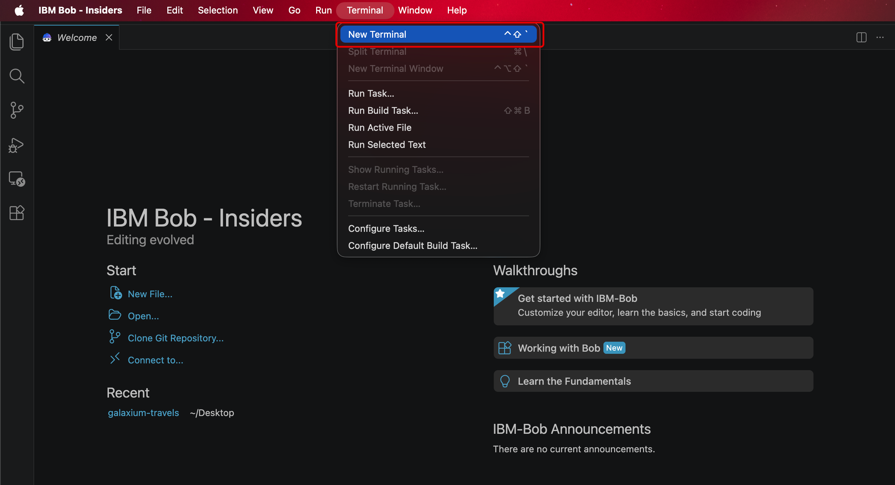

**GETTING STARTED**
# **SETUP & REGISTRATION**

---

## **i. Before you begin**


!!! note ""
    Christopher Bienko *(AI Enablement GTM Product Manager)* provides an overview of the *Setup and Registration* module for the hands-on enablement. **<a href="https://ibm.seismic.com/Link/Content/DCh7mpg7FJc8V8hRCPdcPF8dJbcB" target="_blank">[2 min]</a>**

Before diving into the hands-on modules, complete the following registration and setup steps to prepare your machine with an authenticated **IBM Bob** account and a local copy of the *finance dashboard* starter repository, which every module in this courseware builds upon. Afterwards, you will be ready to begin **Part 1 | Build**.

---

## **ii. Choosing how to access Bob**

Before installing the demo application, you need an authenticated **IBM Bob account**. There are two registration paths to obtain one— as well as a shortcut if you already have access —and the few minutes you spend now, choosing the right one, can save you a great deal of time later.

| | TRIAL | INTERNAL |
|--|-------|----------|
| **Audience** | Anyone, including Business Partners (and IBMers using a personal email) | IBMers only |
| **Approval time** | Under 10 minutes | 24+ hours |
| **Access duration** | 1 month | Indefinite |
| **Bobcoin balance** | 40 Bobcoins | 100 Bobcoins (tied to your w3id) |
| **Registration email** | Must use a **non-IBM** email address | Your IBM w3id |

!!! warning "WHICH PATH SHOULD I CHOOSE?"

    - **IBM REGULAR EMPLOYEES: <a href="https://bienko.github.io/bob-cobol-java/setup/#iii-ibmers-internal-registration" target="_blank">"Internal" registration</a>**
    - **BUSINESS PARTNERS: <a href="https://bienko.github.io/bob-cobol-java/setup/#iv-business-partners-trial-registration" target="_blank">"Trial" registration</a>**
    
    **Trial account registration** is the right choice if you are under time constraints, are a Business Partner, or have previously maxed out your Bobcoin balance. *(IBMers may use the Trial as well, though Internal is the official recommendation.)* Its 40 Bobcoins are more than enough to complete this lab, and access lasts a month — ample time, and easily renewed by creating another Trial account.
    
    **Internal account registration** is the right choice if you are an IBMer, aren't in a rush, and would like to keep exploring Bob beyond this lab. Note that the 100-Bobcoin balance is tied to your w3id, so if you have exhausted it elsewhere, that limit still applies here.
    
    **Already have IBM Bob?** Skip both registration paths entirely and jump ahead to *Installing the COBOL demo app*. This assumes you have already installed and authenticated IBM Bob prior to this course.

---

## **iii. IBMers: Internal registration**

The Internal registration path is the appropriate route for IBM regular employees to register for IBM Bob access.

---

1. Begin at the [**Bob Enterprise Sales Assets**](https://techzone.ibm.com/collection/bob-enterprise-sales-assets?utm_source=skills_network&utm_content=in_lab_content_link&utm_id=Lab-Demonstration+Guide+%5BBob+L3%5D-v1_1777325986) page.

    Once there, click **Technical Resources** in the left sidebar.

    <p align="left">
    
    </p>

---

2. Click **See it** under the *"Internal Bob Sign Up"* tile.

    <p align="left">
    
    </p>

---

3. You will be redirected to a sign-up form. Enter all of the requested information and press **Submit.**

    <p align="left">
    
    </p>

---

4. Review your responses if you like, then confirm by clicking **Submit** once more in the pop-up window.

    There will be a *"Thank you"* pop-up that appears afterward — you can simply dismiss it.

    <p align="left">
    
    </p>

---

5. After submission, you will receive a confirmation email.

    <p align="left">
    
    </p>

---

6. At this point you will need to wait — as noted, approval typically takes at least 24 hours.

    Once approved, you will receive an email — follow the **Download Bob** hyperlink within it.

    <p align="left">
    
    </p>

---

7. The *Download Bob* link opens a Box folder containing download links for various operating systems. Locate the version appropriate for your OS and click it.

    <p align="left">
    
    </p>

---

8. Click the appropriate file within the folder.

    <p align="left">
    
    </p>

---

9. Click **Download**.

    <p align="left">
    
    </p>

---

10. Review the License Agreement, and if you accept its terms and conditions, toggle `I accept the agreement` and press **Next.**

    <p align="left">
    
    </p>

---

11. Continue through the GUI-based install process common to most desktop software — review the instructions on each Setup page to configure Bob to your liking, and press **Next** to proceed.

    <p align="left">
    
    </p>

---

12. Installation should take roughly 5–10 minutes.

    <p align="left">
    
    </p>

---

13. A completion pop-up appears.

    Tick **Launch IBM Bob** (if it is not already checked) and press **Finish**.
    <p align="left">
    
    </p>

---

14. IBM Bob opens. Click **Log in to Bob**.

    <p align="left">
    
    </p>

---

15. When prompted *The extension IBM Bob wants to sign in using Bob.*, click **Allow** to launch a web browser for authentication.

    Log in within the browser using your *IBMid* and *password* - those which are linked to the IBM Bob account you registered for in the previous steps.

    <p align="left">
    
    </p>

---

16. A few additional prompts may arise before authentication can complete:

    - If asked *"Do you want to allow this website to open IBM Bob?"*, click **Yes**
    - Wait until the web browser refreshes to read *Authentication Successful!* before closing the browser window
    - Return to the Bob IDE, which has now been successfully authenticated and connected to the IBM Bob service

    <p align="left">
    
    </p>

---

## **iv. Business Partners: Trial registration**

The Trial path provides fast access, a fresh balance of 40 Bobcoins, and is open to the widest audience (**Business Partners included**). Access lapses after one month, which is more than enough time to complete this lab.

---

1. Begin at the **Free Trial** sign-up page:

    !!! note ""
        **<a href="https://bob.ibm.com/trial?utm_source=skills_network&utm_content=in_lab_content_link&utm_id=Lab-Demonstration+Guide+%5BBob+L3%5D-v1_1777325986" target="_blank">https://bob.ibm.com/trial?utm_source=skills_network&utm_content=in_lab_content_link&utm_id=Lab-Demonstration+Guide+%5BBob+L3%5D-v1_1777325986</a>**

    <p align="left">
    
    </p>

---

2. Check the inbox of the email you registered with, which should arrive nearly instantly.

    **Copy the 7-digit verification code** and return to the open IBM Bob Free Trial tab.

    <p align="left">
    
    </p>

---

3. Enter the **7-digit verification code** and press **Submit**.

    <p align="left">
    
    </p>

---

4. After submitting, you will be redirected to a confirmation page. Wait a few seconds until *"Your trial is ready!"* appears, then press **Access your trial now.**

    <p align="left">
    
    </p>

---

5. You will land on the *"Download Bob"* page. **Download** IBM Bob for your respective operating system. It follows the simple GUI-based install process you would expect of most desktop applications.

    <p align="left">
    
    </p>

---

6. Once IBM Bob has finished installing, **open IBM Bob** (if it has not opened already).

    Then press **Log in to Bob**.

    <p align="left">
    
    </p>

---

7. Press **Allow** on the pop-up window.

    <p align="left">
    
    </p>

---

8. Press **Open** on the subsequent pop-up window.

    <p align="left">
    
    </p>

---

9. On the IBM Verify sign-in page, expand the *"Choose an option"* drop-down and press **IBMid.**

    <p align="left">
    
    </p>

---

10. You should be redirected to an **"Authentication Successful!"** screen.

    Afterward, **return to the tab with IBM Bob open.**

    <p align="left">
    
    </p>

---

11. Press **Open** on the new window that has appeared on the IBM Bob screen.

    <p align="left">
    
    </p>

---

12. Look to the Agentic Sidebar — the window for entering prompts has opened. You have now successfully accessed your authenticated IBM Bob account.

    <p align="left">
    
    </p>

---

## **v. Download the lab assets**

!!! success "PREREQUISITES"

    **If you do not already have them installed, you will need the following:**

    - **Node.js 20 LTS or newer** — <a href="https://nodejs.org/en/download" target="_blank">Download</a>
    - **Git 2.30+** — <a href="https://git-scm.com/downloads" target="_blank">Download</a>

    `npm` is bundled with Node.js. A GitHub account is required for **Part 2 | Evolve**.

With IBM Bob authenticated, the final piece of setup is a local copy of the *finance dashboard* starter repository — the shared baseline that every module in this lab builds upon. It contains the workshop docs, the pull request template, the CI workflow scaffold, and an empty project structure ready for Bob to populate.

---

1. Open a new **Terminal** window within the Bob IDE by either navigating to **Terminal** > **New Terminal** from the top-line task bar, or by pressing the ++ctrl+shift+grave++ shortcut on your keyboard.

    Copy the following instruction and execute inside the Terminal console (hit the ++return++ key) to clone the `github-sdlc-automation` Project contents (containing all of the lab assets for this lab) from GitHub onto your local machine: 

    ``` bash
    git clone -b github-sdlc-automation https://github.ibm.com/kkamil-ibm/bobl3.git
    ```

    !!! warning "TROUBLESHOOTING: Unable to access GitHub"
        If you are unable to clone the repository from GitHub, or want to skip linking your personal GitHub account to the IBM enterprise GitHub organization, you can download and extract the same assets from Seismic:

        **URL: <a href="https://ibm.seismic.com/Link/Content/DCgb3D6pGjqW984MF2PJPTWFdVgP" target="_blank">https://ibm.seismic.com/Link/Content/DCgb3D6pGjqW984MF2PJPTWFdVgP</a>**
    
    

---

2. Next, change into the `Github SDLC Automation` directory by copying & pasting into the Terminal console the command that **matches your operating system**, then press ++enter++ to execute:

    ??? quote "MAC OR LINUX"
        ``` bash
        cd ~/"Github SDLC Automation"
        ```
    ??? quote "WINDOWS OS"
        ``` bash
        cd "$HOME\Github SDLC Automation"
        ```

---

3. Finally, click the **Explorer** tab (++ctrl+shift+e++) from the left-hand side of the Bob IDE.

    - Next, click **Open Folder** and locate the `Github SDLC Automation` directory that was cloned in the previous step — most likely within your home or user-profile directory
    - Double-click on the directory or press **Open**
    - If prompted, click **"Yes, I trust the authors"**

---

## **vi. Next steps**

**Setup is complete:** IBM Bob has been successfully authenticated and the project contents are now open within the Bob IDE. You are ready to begin the hands-on work and watch Bob operate inside a production-style delivery workflow, exactly as it would within a client's real project.

!!! note ""
    *The journey proceeds through six phases of construction:*

    **Application scaffolding.** Use IBM Bob to analyze the repository and propose a structured build plan, generate a React application skeleton with clear folder boundaries, create reusable chart card components, and set up a service layer for external data.

    **Data integration.** Use IBM Bob to implement a Yahoo Finance data service for IBM and four competitors, normalize responses so the UI can render consistent shapes, handle missing or partial data gracefully, and keep the design extensible for additional companies.

    **Dashboard views.** Use IBM Bob to build a current-day market summary view, a 7-day trend comparison view, and a quarterly comparison view — combining line charts, area charts, and summary cards for readability.

    **Validation and tests.** Use IBM Bob to add unit tests for the data transformation layer, add a rendering test for at least one dashboard path, provide commands to run checks locally, and interpret validation results to diagnose failures.

    **GitHub delivery.** Use IBM Bob to review the uncommitted diff and summarize the changes, draft a clean commit message and initial PR description, push the app to a new GitHub repository, and enable Issues, Pull Requests, and a CI workflow.

    **GitHub-driven evolution.** Use IBM Bob to fetch a GitHub issue for a new feature request, analyze the request and define acceptance criteria, implement a user-selected company chart without breaking the existing views, run validation on the updated branch, generate a pull request description grounded in the actual diff, and prepare the branch for merge or automated closure.

Onward to **<a href="https://bienko.github.io/bob-sdlc/" target="_blank" rel="noopener noreferrer">Part 1 | Build</a>**, where you'll use Bob to scaffold the finance dashboard, integrate Yahoo Finance data, add validation, and prepare the initial delivery for GitHub.

---